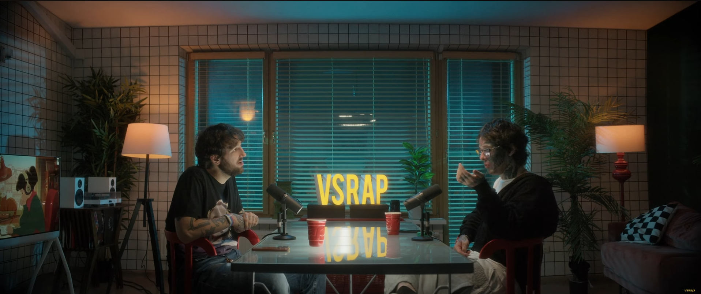
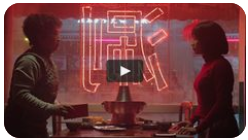
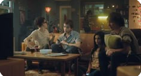
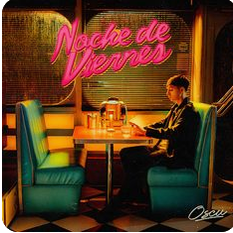
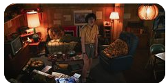
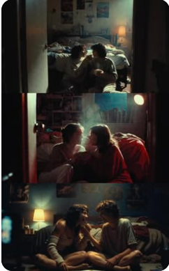
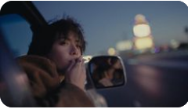
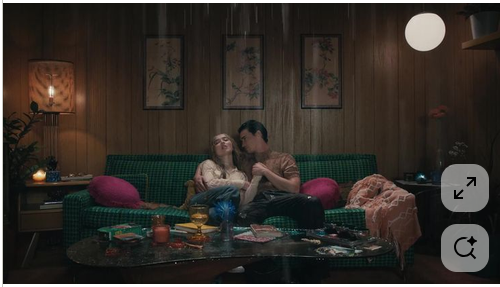
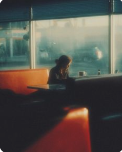
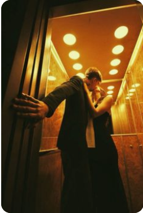

# Venus · Visual Direction / Atmosphere / Moodboard

**Owner:** Art Direction · **version:** 1.0.0 · **status:** visual concept accepted; design tokens proposed · **date:** 2026-10-18.

## 1. Эмоциональный бриф

Venus **не должен выглядеть** как инструментарий веб-конференций или привычный SaaS. Это приглашение в квартиру поздним вечером. Из панорамных окон идёт холодный голубой свет дождливого города; внутри — мягкие оранжевые бумажные светильники, друзья на диване, бархатное тепло мебели, музыка и близость. Окно немного приоткрыто: рано или поздно придётся выйти наружу, потому хочется остаться ещё на пару минут.

**После вечера:** лёгкая дымка памяти, тёплая шероховатость изображения, след духов на одежде, незапланированная улыбка. Молодость и неформальная близость, но не инфантильность, не показная сексуализация, не маркетинговый «романтический сайт».

### Три пространственных слоя

1. **Outside / cold:** дождь, окна, мокрый город, отражённый сине-зелёный свет, ночная прохлада.
2. **Inside / warm:** торшеры, гирлянды, приглушённый медово-янтарный свет, дерево, ткань, мягкие красно-коричневые тона, неидеально прибранная жизнь.
3. **Afterglow / memory:** низкая контрастность фона, мелкое зерно, мягкий halo/reflection, неинвазивная пленочная дымка; намеренная эстетика не снижает контраст текста.

Между ними небольшие **акцентные зоны** южнокорейской городской эстетики: хангыль в редкой осмысленной вывеске, спокойный неон, ритм камерной фотосъёмки, кафе/квартира, а не «азиатская тема» для декора.

## 2. Ключевые ассоциации и запреты

| Применять | Не применять |
|---|---|
| late-night warmth, rainy windows, house party, quiet intimacy | cyberpunk, nightclub, oversized LED signage |
| film-grain texture, matte glass, lamps with halos | glossy sci-fi glassmorphism, bright stock gradients |
| atmospheric photographs with human proximity and comfortable distance | постановочное избыточное веселье/«вечеринка в стоковом офисе» |
| jazz / lounge / dream-pop moods | cartoon/kawaii, emoji-heavy infantile branding |
| editorial rhythm / spacious negative space | длинный лендинг с десятью рекламными карточками |
| rare meaningful Korean hangul signage | случайные псевдоиероглифы и ложные переводы |
| accessible clear foreground controls | бледный текст на видеофоне без затемнения |

## 3. Основной референс: вечерняя комната

**Изображение `ref-00` — первичное, приоритетное.** Взять: большую геометрию окна; холодный наружный свет и локальные тёплые источники; ощущение, что внутри безопасно; интимный масштаб компании; низкий кинематографичный свет; слегка несовершенное пространство. **Не** копировать логотипы/надписи на реальном кадре, персонажей, композицию кадр-в-кадр или охраняемый исходный художественный материал в публичную обложку без разрешения.

## 4. Дополнительные визуальные референсы автора

Все файлы скопированы без художественной переработки из прикреплённых автором изображений (в низком исходном разрешении многие годятся **для moodboard, а не публикации на сайте**). Нумерация соответствует именам файлов в `.docs/assets/references/`.

### 4.1. Neon, urban warmth, casual intimacy

| Изображение | Берём | Избегаем |
|---|---|---|
|  | малую локальную зону красного/розового неона, силуэты | агрессивное красное освещение всей сцены |
|  | живая компания, близкие неидеальные жесты, мебель | шаблонно-отполированную рекламу |
|  | вечернее кафе, glow, teal/amber/rose | широкое применение кислотного неона |
|  | ламповая неформальная квартира, вещность | чрезмерную захламлённость UI |

### 4.2. Personal afterglow / memory

| Изображение | Берём | Избегаем |
|---|---|---|
|  | близость, естественная поза, почти видимый воздух | постановочные сексуализированные клише |
|  | город в расфокусе, поздняя дымка, память | депрессивность как главный тон |
|  | камерная древесная текстура, детали стола, пауза | копировать чужую художественную сцену буквально |
|  | влажный свет, aftermath, контраст тёплого и холодного | обесцвеченный грязно-серый UI |
|  | экспрессивный тёплый свет, интимный силуэт | переизбыток жёлтого как основного фона |

### 4.3. Сайты-ориентиры (ссылки, не код-доноры)

1. **https://valentines.wannathis.one/** — мягкое романтическое дружелюбие, выразительные детали, но избежать прямолинейных сердечек/игрушечности.
2. **https://www.agencepony.fr/** — редакционная композиция, сдержанная индивидуальность, повествовательная структура; **не заимствовать панель меню**.
3. **https://loveeez.com/** — эмоциональный playful character; использовать дозированно, **не переносить** kawaii/иллюстративные клише в основные экраны.
4. **https://www.houseofhoney.com/?ref=minimal.gallery** — интерьерная глубина, слои пространства, материальность, смысловая тишина.

Все сайты могут измениться. Для acceptance главнее этот текст/локальные рефы, не текущий HTML чужого сайта. Товарные знаки, фотографии и шрифты не копировать без прав и аудита лицензий.

## 5. Дизайн-токены: первоначальная система цветов

Палитра является **проектным baseline** для Figma/CSS tokens; тест контрастности и визуальный просмотр на реальных экранах обязательны.

| Token | HEX | Роль |
|---|---|---|
| `--night-950` | `#171D23` | глубокий холодный фон, ночной контраст |
| `--charcoal-900` | `#25272C` | основная нейтральная поверхность |
| `--ink-warm-850` | `#332A2B` | тёплый темный UI |
| `--teal-fog-700` | `#466D71` | холодный интерьерный свет, decorative |
| `--blue-rain-500` | `#72949D` | отражение дождя, secondary details |
| `--smoke-plum-600` | `#6B5761` | muted romantic tone |
| `--wine-rose-500` | `#B97985` | редкие кнопочные и неоновые акценты |
| `--amber-350` | `#DEA67A` | бумажная лампа / low-glow |
| `--paper-150` | `#F1E7D9` | primary text on dark surfaces |
| `--cream-100` | `#FAF2E7` | светлый контент/карточки |
| `--warm-gray-400` | `#A99B97` | quiet metadata (при достаточном контрасте) |
| `--red-danger` | `#B85157` | явная опасность/stop, не декоративный неон |

**Иерархия:** 70% глубокая тёмная база; 20% тёплая материальность; 8% холодный window light; не больше 2% яркого неона одновременно в экране. Проценты — стилистические ориентиры, не технический закон.

### 5.1. Accessibility over atmosphere

WCAG 2.2 AA по смыслу: обычный текст контраст минимум 4.5:1; крупный минимум 3:1, state/interactive outline по применимым критериям. Проверять **реальную контрастность с наложениями/blur**, а не только HEX. Текст на hero помещать в градиентный затемнённый overlay. Не ограничивать интерфейс цветом: active/paused/error также имеют слова/иконки.

## 6. Типографика

- **UI:** Manrope или близкий лицензируемый современный grotesk с корректной поддержкой кириллицы, английского и турецких `Ç Ğ İ ı Ö Ş Ü`. Предпочтительны 400/500/600/700 и font-feature settings с читаемыми цифрами.
- **Editorial accent:** Cormorant Garamond / аналог с подтверждённым набором glyphs по локалям, только для hero/вставок (не в кнопках и карточных заданиях). Недостающая кириллица = fallback, а не пустые символы.
- **Korean decorative:** Noto Sans KR или лицензированный аналог, только для проверенных осмысленных коротких надписей; хангыль — **алфавит корейского языка**, а не универсальные «иероглифы».
- **Размеры:** 15–17px body desktop; 16–18px mobile; headline с `clamp(2.3rem,5vw,5.7rem)`; card question 22–32px desktop, mobile 20–26px; кнопки min 16px. No <14px критического текста.
- Интерфейс должен корректно переносить длинные RU и Turkish strings без ellipsis для критических действий. Не капслочить весь текст.

## 7. Материалы / фактуры

**Material stack:** чуть запотевшее стекло (`backdrop-filter` осторожно), дерево и мягкие ткани в фотофонe, полупрозрачные карточки, шероховатая бумага для game cards, округлые углы 16–24px, длинная мягкая тень без «дешёвого» стеклянного свечения.

**Grain:** лёгкий и статичный, малоконтрастный (например opacity 0.03–0.06), желательно растровый отдельный слой; избегать мерцания/шума на тексте. Decorative shader нельзя запускать с частотой, которая убивает мобильный FPS или контрастность.

**Neon:** редкая вывеска в изображении, small label/active outline и узкая тёплая подсветка; никакого бесконечного flicker или пульсирующего UI как в клубе. Использовать только корректные переводы корейских слов, например `오늘 밤` = «сегодня вечером/ночью», с проверкой носителем перед публикацией; не делать его основным пунктом навигации.

## 8. Hero: «вход в комнату»

### 8.1. Desktop composition

- Занимает viewport и выглядит **как одна сцена**, а не «секция 1 длинного SaaS лендинга».
- Окно/город — в средней/правой области; тёплый свет и друзья — в глубине; существенная тёмная negative space под текст слева/снизу; CTA отделён от фото тёплой полупрозрачной подложкой.
- Текст минимален: `VENUS`; короткое приглашение; `Создать комнату` и `Войти по ссылке/коду`. Никаких анимаций, требующих клика для понимания назначения продукта.
- Нет чужого видеоплеера или декоративных элементов, которые можно принять за кнопку.

### 8.2. Mobile recomposition

- Не масштабировать огромный desktop layout целиком: менять кадрирование, затемнение, положение светильника/окна и фокус, сохранять лица/лампы от обрезания.
- Указывать object-position отдельно для portrait/landscape; на маленьком экране допускается альтернативный разрешённый artwork/crop.
- CTA в safe area нижней половины; text background стабильный, клавиатура не перекрывает form; заголовки не вылезают.
- `100dvh` и fallback, `viewport-fit=cover`; минимум горизонтального переполнения при 320 CSS px.

## 9. Room interior / module visual consistency

Игровые карточки должны выглядеть как вещи из этого пространства: тёплая бумага, матовое покрытие, умеренная типографическая экспрессия. Три режима получают различимые accent color, но одинаковую сетку/место текста. Cinema — контент на первом плане с темной управляющей панелью; Games — акцентный центр; Music — тонкая полоска с названием трека и альбомным изображением. Calls позже не может заслонять CTA/игровые карточки.

**Палитра трёх режимов (предложение):** Questions — дымный slate `#343844`; Truth or Dare — dusted rose `#694D51`; Yes, But — forest fog `#465B59`. Каждая сторона двухсторонней карточки различима по подписи/иконке даже при выключенном цвете.

## 10. Motion direction

- Scene entrance: opacity+translate 12–24px, 250–450ms, ease-out; reduced-motion => no transform.
- Переворот карточки: 300–450ms, front/back semantics, focus properly updated, альтернатива «показать другую сторону» без 3D.
- Изменение света/отражений: крайне медленно 8–20s, opacity слабая, no flashes.
- Кнопки: 120–180ms, явное pressed/disabled/loading состояние; срочные действия `Отказаться`, `Пропустить`, `Остановить` мгновенно доступны, не ждать завершения анимации.
- Любая видео-заставка/анимированный hero при мобильном reduced-data, `prefers-reduced-motion`, low-power переводится в статичное изображение.

## 11. Требования к художественным ассетам

**Формат:** мастер 16:9/2.39:1 с safe compositions 4:3 и 9:16; правильные rights+usage+source+credit; exports AVIF/WebP plus fallback; минимальный фронтальный текст в hero должен оставаться читаемым. Только лицензионные или оригинальные фото/рендеры; user-provided refs являются **референсами**, а не автоматически разрешённым коммерческим исходником.

Минимальные deliverables дизайнера: desktop/portrait/landscape hero; master palette/token sheet; 3 card treatments front/back; music slim bar; shared camera/film container; empty/loading/error states; reduced-motion alternatives; RU/EN/TR string stress-test boards; accessibility notes.

## 12. Acceptance checklist

- [ ] Узнаётся «вечерняя комната» без текста, присутствует температурный контраст outside/inside.
- [ ] Неон акцентен, не доминирует; хангыль смысловой и корректно написан.
- [ ] UI читается поверх любых разрешённых атмосферных фото, метрики контраста сохранены.
- [ ] 320/375/768/1024/1440/1920 и portrait/landscape имеют композиционные решения, не механическое уменьшение.
- [ ] Есть alt/кредит/лицензия у production assets; moodboard-only не попал в production bundle.
- [ ] Все критические действия можно выполнить без анимации и разглядывания текста.
- [ ] Нет видимых scrollbar на ключевых поверхностях, но переполненное содержимое читается/доступно согласно 04.
